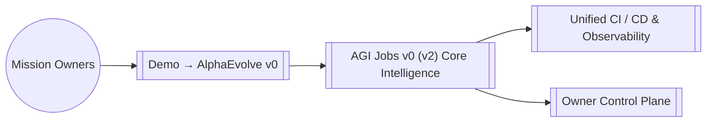

# AGI Jobs v0 (v2) — Demo → AlphaEvolve v0

Explore a bounded local search over job-allocation heuristics. Compare candidate
utility, modeled cost, fairness and acceptance against a supplied baseline, then
inspect why guardrails accepted or rejected each generation.

## Run the implemented experiment

```bash
python demo/AlphaEvolve-v0/run_demo.py run --seed 7 --generations 5 --output /tmp/alphaevolve-report.json
python -m pytest demo/AlphaEvolve-v0/tests
```

The root launcher uses `alphaevolve_runner.py` and `alphaevolve/`. It generates
synthetic agents/jobs and uses `ScriptedLLMClient` to propose bounded heuristic
changes. The evaluator computes outcomes locally; no live model, wallet, contract
transaction or real purchase occurs. Cost and utility are model quantities, not
measured provider bills or earned revenue. A passing guardrail authorizes only
promotion within this local search experiment.

The JSON report includes baseline/final/champion metrics, per-generation decisions,
guardrail reasons and explicit execution-scope fields. Existing `alphaevolve_demo/`
is a separate implementation; do not assume a test of this launcher qualifies it.
The broader integration diagram below describes the design context, not an automatic
production route established by this command.

## Systems Map


## Working With This Module
1. From the repository root run `npm install` once to hydrate all workspaces.
2. Inspect the scripts under `scripts/` or this module's `package.json` entry (where applicable) to discover targeted automation for `demo/AlphaEvolve-v0`.
3. Execute `npm test` and `npm run lint --if-present` before pushing to guarantee a fully green AGI Jobs v0 (v2) CI signal.
4. Capture mission telemetry with `make operator:green` or the module-specific runbooks documented in [`OperatorRunbook.md`](../../OperatorRunbook.md).

## Directory Guide
### Key Directories
- `alphaevolve`
- `alphaevolve_demo`
- `config`
- `tests`
- `web`
### Key Files
- `__init__.py`
- `alphaevolve_manifest.json`
- `alphaevolve_runner.py`
- `alphaevolve_summary.json`

## Quality & Governance
- Every change must land through a pull request with all required checks green (unit, integration, linting, security scan).
- Reference [`RUNBOOK.md`](../../RUNBOOK.md) and [`OperatorRunbook.md`](../../OperatorRunbook.md) for escalation patterns and owner approvals.
- Keep secrets outside the tree; use the secure parameter stores wired to the AGI Jobs v0 (v2) guardian mesh.

## Next Steps
- Review this module's issue board for open automation, data, or research threads.
- Link new deliverables back to the central manifest via `npm run release:manifest`.
- Publish artefacts (dashboards, mermaid charts, datasets) into `reports/` for downstream intelligence alignment.
