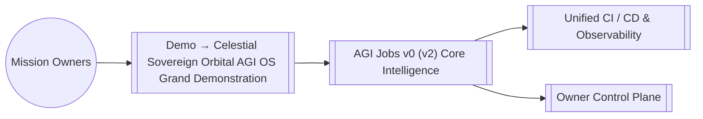

# AGI Jobs v0 (v2) — Demo → Celestial Sovereign Orbital AGI OS Grand Demonstration

> AGI Jobs v0 (v2) is our sovereign intelligence engine; this module extends that superintelligent machine with specialised capabilities for `demo/CELESTIAL-SOVEREIGN-ORBITAL-AGI-OS-GRAND-DEMONSTRATION`.

## Run the resource outage planning desk

This bounded, offline rehearsal compares infrastructure job reservations before and during a declared capacity outage. It reuses the existing Omega demo's `ResourceManager.reserve_budget` engine. It does not control satellites, energy systems, compute workers, wallets or production jobs.

```sh
python demo/CELESTIAL-SOVEREIGN-ORBITAL-AGI-OS-GRAND-DEMONSTRATION/run.py
python demo/CELESTIAL-SOVEREIGN-ORBITAL-AGI-OS-GRAND-DEMONSTRATION/run.py path/to/scenario.json
python -m pytest test/simulation/test_celestial_contingency.py
```

Python 3.12 and the standard library run the rehearsal; the repository's test dependencies provide pytest. Input is strict JSON with unique keys, bounded integers, unique job identifiers and explicit normal/outage capacities. Energy and compute units are declared planning units, not measured physical quantities or token balances.

The default normal plan reserves communications, backups, indexing and archive compression. The outage plan keeps communications and backups while deferring the two lower-priority requests. Every phase reports held reserve, shortfall, allocated and remaining units, and verifies conservation independently of the reservation engine. If the outage cannot cover the protected reserve, all dispatch is paused, even if some capacity remains in the other resource.

Higher priority wins; equal priority preserves input order. Jobs are indivisible. A large request that does not fit is deferred while later smaller requests may fit. This greedy rule does not promise global optimality. The two plans are independent snapshots: a displaced job represents a changed plan, not an actual cancellation, successful recovery or execution. No monetary reward, price, transfer or stake operation is invoked.

The CLI prints a JSON result with the SHA-256 of the exact input bytes. Exit `0` means a valid plan; `1` means protected-reserve shortfall pauses outage dispatch; `2` means invalid or unreadable input. Deferred jobs may remain in an otherwise valid plan. All execution, production and settlement approval flags stay false.

## Preserved design context

The original diagram and design below describe broader goals. The implemented capability is the bounded resource reservation comparison above.

## Overview
- **Path:** `demo/CELESTIAL-SOVEREIGN-ORBITAL-AGI-OS-GRAND-DEMONSTRATION/README.md`
- **Module Focus:** Anchors Demo → Celestial Sovereign Orbital AGI OS Grand Demonstration inside the AGI Jobs v0 (v2) lattice so teams can orchestrate economic, governance, and operational missions with deterministic guardrails.
- **Integration Role:** Interfaces with the unified owner control plane, telemetry mesh, and contract registry to deliver end-to-end resilience.

## Capabilities
- Provides opinionated configuration and assets tailored to `demo/CELESTIAL-SOVEREIGN-ORBITAL-AGI-OS-GRAND-DEMONSTRATION` while remaining interoperable with the global AGI Jobs v0 (v2) runtime.
- Ships with safety-first defaults so non-technical operators can activate the experience without compromising security or compliance.
- Publishes ready-to-automate hooks for CI, observability, and ledger reconciliation.

## Systems Map


## Working With This Module
1. From the repository root run `npm install` once to hydrate all workspaces.
2. Inspect the scripts under `scripts/` or this module's `package.json` entry (where applicable) to discover targeted automation for `demo/CELESTIAL-SOVEREIGN-ORBITAL-AGI-OS-GRAND-DEMONSTRATION`.
3. Execute `npm test` and `npm run lint --if-present` before pushing to guarantee a fully green AGI Jobs v0 (v2) CI signal.
4. Capture mission telemetry with `make operator:green` or the module-specific runbooks documented in [`OperatorRunbook.md`](../../OperatorRunbook.md).

## Directory Guide
This folder preserves the design guide; use the related executable workflow linked above.

## Quality & Governance
- Every change must land through a pull request with all required checks green (unit, integration, linting, security scan).
- Reference [`RUNBOOK.md`](../../RUNBOOK.md) and [`OperatorRunbook.md`](../../OperatorRunbook.md) for escalation patterns and owner approvals.
- Keep secrets outside the tree; use the secure parameter stores wired to the AGI Jobs v0 (v2) guardian mesh.

## Next Steps
- Review this module's issue board for open automation, data, or research threads.
- Link new deliverables back to the central manifest via `npm run release:manifest`.
- Publish artefacts (dashboards, mermaid charts, datasets) into `reports/` for downstream intelligence alignment.
