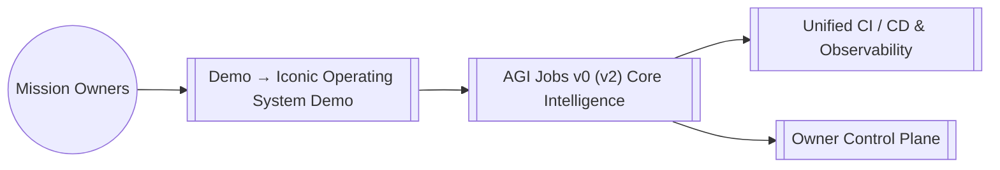

# AGI Jobs v0 (v2) — Demo → Iconic Operating System Demo

> A supplier-evidence desk: inspect real browser deliverables and distinguish a correct result from an incomplete execution report.

## Run the implemented evidence desk

```sh
python demo/ICONIC-OPERATING-SYSTEM-DEMO/run.py
python -m unittest test.simulation.test_supplier_evidence_desk -v
```

The bundled [packet.json](packet.json) contains the synthetic supplier deliverables produced by an actual Chromium run of the shared Alpha/Jobs laboratory. The existing One-Box reviewer independently recomputes all supplier totals, delivery eligibility and the recommendation. It accepts these artifacts. The desk still returns `packetComplete: false` and exit status 1 because provider usage and cost are unknown. Unknown values remain `null`, never zero.

This is offline evidence review. Browser observations, call counts and reported costs in a supplied packet are unauthenticated declarations. Artifact hashes establish byte integrity, not the identity of an executor or truth of a claim. `packetComplete` means reported fields are complete under the supplied policy, not that execution or cost has been verified. Even a complete packet returns `executionAttested`, `costAttested`, `admitted`, `productionApproved` and `settlementApproved` as false. Passing these checks never admits, pays or approves production work.

### Inspect a packet

Copy the fixture and run `python demo/ICONIC-OPERATING-SYSTEM-DEMO/run.py --packet YOUR_COPY.json`. The schema separates:

- `receipt.artifacts`: exactly two bounded deliverables from the existing supplier task, each with its content and SHA-256.
- `taskSourceSha256`: the exact repository One-Box task-file commitment; matching it does not attest a live market assignment.
- `execution`: reported browser observation, provider call count, external fetch count and worker cleanup, with an explicit scripted-laboratory or reported-live-provider mode.
- `usage`: reported input/output tokens and integer micro-US-dollar cost, or `null` for unknown values.
- `policy`: caller-selected maximum reported calls, input/output tokens and micro-US-dollar cost. This reviews supplied values; it is not a runtime spending limiter or invoice verification.

The default synthetic task allows no external fetches. Edit the recommendation to the cheaper but late supplier and recompute its checksum: the arithmetic reviewer still rejects it. Exceed a reported budget, change the task digest, claim production approval or report incomplete worker cleanup: the corresponding completeness gate fails. Providing valid reported usage can complete the packet, but does not make that usage attested. Duplicate keys (including in the embedded comparison JSON), unknown fields, nonfinite values, unsafe integers and oversized input are rejected.

The result includes all eleven artifact checks, separate completeness gates, unresolved reasons, exact artifact commitments and a SHA-256 of the input packet bytes. Exit 0 means the report is complete under the supplied policy; 1 means a valid report has unresolved gates; 2 means malformed input or an unavailable reviewer. Node is required for the existing One-Box reviewer, with a five-second subprocess deadline. No provider, wallet, chain or external API is called.

### Browser evidence workspace

Serve `web/` locally with `python -m http.server 8080 --bind 127.0.0.1 --directory demo/ICONIC-OPERATING-SYSTEM-DEMO/web` and open `http://127.0.0.1:8080/`. The EN/FR desk separates the eleven artifact checks from reported-field completeness. Edit usage/policy, leave unknown values blank, import or export a packet, and reopen evidence with its result independently recomputed. The Pages build publishes this workspace at `experiments/iconic/` after deployment. All original source fixtures remain hash-bound by tests.

### Connect real browser work

The canonical reproducible laboratory is [the Alpha supplier browser harness](https://github.com/MontrealAI/AGIJobsv0/blob/fee0f3e3ab9e0bad0e5d1d2d6f145eccf9b2151a/integrations/alpha-agent/SUPPLIER_BROWSER_LAB.md) in PR3936. It drives actual Chromium through the fixed Alpha worker using scripted Responses fixtures, retains screen/action evidence, and verifies process-group cleanup. Its positive and deliberately corrupted recommendation runs establish the evidence desk's fixture provenance. This is not a live-model reasoning evaluation or Docker production qualification.

For a separately authorized live execution path, use [the existing computer-work guide](../../docs/computer-work.md) and its admitted task/runtime profile. Native Responses computer tools and OpenClaw client-function tools are separate backend surfaces. The evidence desk does not create credentials, infer provider costs, automatically retry requests, expand permissions, or convert a Manager grant into JobRegistry authority. Production identity, signature, chain/profile/assignment and controller permissions require the appropriate existing independent gates.

## Preserved wider design

The following architecture describes a broader design than the bounded evidence desk. Original diagrams are retained as context, not execution evidence.

## Overview

- **Path:** `demo/ICONIC-OPERATING-SYSTEM-DEMO/README.md`
- **Module Focus:** Anchors Demo → Iconic Operating System Demo inside the AGI Jobs v0 (v2) lattice so teams can orchestrate economic, governance, and operational missions with deterministic guardrails.
- **Integration Role:** Interfaces with the unified owner control plane, telemetry mesh, and contract registry to deliver end-to-end resilience.

## Capabilities

- Provides opinionated configuration and assets tailored to `demo/ICONIC-OPERATING-SYSTEM-DEMO` while remaining interoperable with the global AGI Jobs v0 (v2) runtime.
- Ships with safety-first defaults so non-technical operators can activate the experience without compromising security or compliance.
- Publishes ready-to-automate hooks for CI, observability, and ledger reconciliation.

## Systems Map



## Working With This Module

1. From the repository root run `npm install` once to hydrate all workspaces.
2. Inspect the scripts under `scripts/` or this module's `package.json` entry (where applicable) to discover targeted automation for `demo/ICONIC-OPERATING-SYSTEM-DEMO`.
3. Execute `npm test` and `npm run lint --if-present` before pushing to guarantee a fully green AGI Jobs v0 (v2) CI signal.
4. Capture mission telemetry with `make operator:green` or the module-specific runbooks documented in [`OperatorRunbook.md`](../../OperatorRunbook.md).

## Directory Guide

This folder preserves the design guide; use the related executable workflow linked above.

## Quality & Governance

- Every change must land through a pull request with all required checks green (unit, integration, linting, security scan).
- Reference [`RUNBOOK.md`](../../RUNBOOK.md) and [`OperatorRunbook.md`](../../OperatorRunbook.md) for escalation patterns and owner approvals.
- Keep secrets outside the tree; use the secure parameter stores wired to the AGI Jobs v0 (v2) guardian mesh.

## Next Steps

- Review this module's issue board for open automation, data, or research threads.
- Link new deliverables back to the central manifest via `npm run release:manifest`.
- Publish artefacts (dashboards, mermaid charts, datasets) into `reports/` for downstream intelligence alignment.
