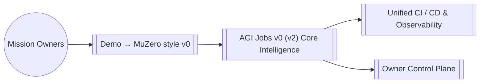

# AGI Jobs v0 (v2) — Demo → MuZero style v0

> AGI Jobs v0 (v2) is our sovereign intelligence engine; this module extends that superintelligent machine with specialised capabilities for `demo/MuZero-style-v0`.

## Run the bounded local planner

The launcher forwards the selected command exactly. Help is available with Python alone:

```sh
python demo/MuZero-style-v0/scripts/run_demo.py --help
python demo/MuZero-style-v0/scripts/run_demo.py smoke-tests --help
```

Training, evaluation and smoke tests require PyTorch for your platform plus this directory's `requirements.txt`, installed in a dedicated environment. Missing dependencies produce an actionable exit code 2 before training. The smoke command performs a small real planning/training check; it is not equivalent to a help or launcher-dispatch test:

```sh
python demo/MuZero-style-v0/scripts/run_demo.py smoke-tests --config demo/MuZero-style-v0/config/muzero_demo.yaml
```

With no arguments the historical full `demo` command remains the default. This is a local simulated job-planning experiment; these commands do not submit or settle on-chain jobs.

## Overview
- **Path:** `demo/MuZero-style-v0/README.md`
- **Module Focus:** Anchors Demo → MuZero style v0 inside the AGI Jobs v0 (v2) lattice so teams can orchestrate economic, governance, and operational missions with deterministic guardrails.
- **Integration Role:** Interfaces with the unified owner control plane, telemetry mesh, and contract registry to deliver end-to-end resilience.

## Capabilities
- Provides opinionated configuration and assets tailored to `demo/MuZero-style-v0` while remaining interoperable with the global AGI Jobs v0 (v2) runtime.
- Ships with safety-first defaults so non-technical operators can activate the experience without compromising security or compliance.
- Publishes ready-to-automate hooks for CI, observability, and ledger reconciliation.

## Systems Map


## Working With This Module
1. From the repository root run `npm install` once to hydrate all workspaces.
2. Inspect the scripts under `scripts/` or this module's `package.json` entry (where applicable) to discover targeted automation for `demo/MuZero-style-v0`.
3. Execute `npm test` and `npm run lint --if-present` before pushing to guarantee a fully green AGI Jobs v0 (v2) CI signal.
4. Capture mission telemetry with `make operator:green` or the module-specific runbooks documented in [`OperatorRunbook.md`](../../OperatorRunbook.md).

## Directory Guide
### Key Directories
- `config`
- `muzero_demo`
- `notebooks`
- `scripts`
- `tests`
- `web`
### Key Files
- `.gitignore`
- `requirements.txt`

## Quality & Governance
- Every change must land through a pull request with all required checks green (unit, integration, linting, security scan).
- Reference [`RUNBOOK.md`](../../RUNBOOK.md) and [`OperatorRunbook.md`](../../OperatorRunbook.md) for escalation patterns and owner approvals.
- Keep secrets outside the tree; use the secure parameter stores wired to the AGI Jobs v0 (v2) guardian mesh.

## Next Steps
- Review this module's issue board for open automation, data, or research threads.
- Link new deliverables back to the central manifest via `npm run release:manifest`.
- Publish artefacts (dashboards, mermaid charts, datasets) into `reports/` for downstream intelligence alignment.
