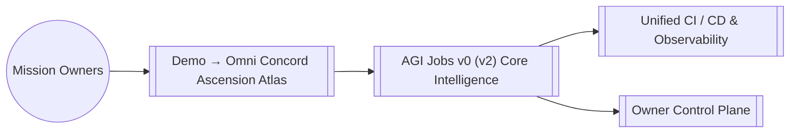

# AGI Jobs v0 (v2) — Demo → Omni Concord Ascension Atlas

> A bounded, inspectable maintenance dependency and recovery rehearsal.

## Run the implemented rehearsal

```sh
python demo/OMNI-CONCORD-ASCENSION-ATLAS/run.py
python -m unittest test.simulation.test_atlas_recovery -v
```

The default synthetic maintenance scenario deliberately fails a repair-plan task. Its dependent verification and report cannot proceed, while an independent audit can finish. A second pass assumes the repair has been corrected, retains previously completed work, charges the retry, and unblocks the downstream tasks. The result spends 19,000 of 20,000 illustrative cents and reaches modeled minute 95. No external work, payment, assignment or settlement is executed.

The rehearsal calls the established [Astral Citadel deterministic graph engine](../astral-citadel/run_demo.py) for dependency ordering. It adds strict input validation, a bounded integer budget ledger, explicit failed-attempt costs and a two-pass recovery model. `recoveredIds` are scenario assumptions, not independently verified repair receipts. Completed work is retained only within this in-memory rehearsal; this is not crash-safe execution or authenticated checkpoint restore.

### Change one thing

Copy [scenario.json](scenario.json), edit it and run with `--scenario YOUR_COPY.json`:

- Set `recoveredIds` to `[]`: the failed repair continues blocking verification and reporting.
- Lower `budgetCents` to 18000: the retry and verification consume the budget, so the final report is blocked with a 1000-cent shortfall.
- Set the budget to 19000: the exact boundary succeeds with zero remaining.
- Add a dependency from inspection to reporting: the existing graph engine rejects the cycle.
- Set a dependency to an unknown job or repeat an identifier: validation rejects the scenario.

JSON output includes first-pass states, final states, every charged attempt, start/finish minutes, remaining budget and an exact-byte scenario SHA-256. Exit status 0 means every modeled task completed; 1 means a valid but incomplete scenario; 2 means malformed input. Unknown fields, duplicate JSON keys, nonfinite numbers, boolean numeric values and ambiguous IDs are rejected. Limits are 100 jobs, 1 MB input and bounded integer amounts/durations.

Ordering follows input order when multiple jobs are ready. Budget is allocated greedily in that deterministic order; the result is not a globally optimized schedule. Independent branches may overlap in modeled time; this deliberately assumes unlimited parallel worker capacity. Recovery begins after the first pass's latest attempt and charges failed work again rather than refunding it. The model has no worker-capacity, provider-cost, live-market or physical-outcome evidence.

### Browser workspace

Serve the `web/` directory locally, for example with `python -m http.server 8080 --bind 127.0.0.1 --directory demo/OMNI-CONCORD-ASCENSION-ATLAS/web`, and open `http://127.0.0.1:8080/`. Switch English/French, edit dependency rows and recovery assumptions, compare the two-pass ledger, and export or reopen an exact scenario/evidence bundle. Saved results are ignored on reopen and recomputed from the scenario. The complete Pages build publishes this same workspace at `experiments/atlas/` once the change is deployed.

### Related full-system local route

[Atlas Conductor](../atlas-conductor/README.md) already provides a separately documented local production-contract lifecycle through the ASI Take-Off harness. Use its runbook and explicit disposable-local setup when contract evidence is needed. This planner does not automatically submit its tasks to that harness or grant production authority. Alpha/Fleet execution still requires the appropriate separate market, task, controller and artifact bindings.

## Preserved wider design

The original systems map and mission playbook describe a larger architecture than the bounded implementation above. Commands that target mainnet in the historical playbook require their own wallet authority and review; the rehearsal does not invoke them.

## Overview

- **Path:** `demo/OMNI-CONCORD-ASCENSION-ATLAS/README.md`
- **Module Focus:** Anchors Demo → Omni Concord Ascension Atlas inside the AGI Jobs v0 (v2) lattice so teams can orchestrate economic, governance, and operational missions with deterministic guardrails.
- **Integration Role:** Interfaces with the unified owner control plane, telemetry mesh, and contract registry to deliver end-to-end resilience.

## Capabilities

- Provides opinionated configuration and assets tailored to `demo/OMNI-CONCORD-ASCENSION-ATLAS` while remaining interoperable with the global AGI Jobs v0 (v2) runtime.
- Ships with safety-first defaults so non-technical operators can activate the experience without compromising security or compliance.
- Publishes ready-to-automate hooks for CI, observability, and ledger reconciliation.

## Systems Map



## Working With This Module

1. From the repository root run `npm install` once to hydrate all workspaces.
2. Inspect the scripts under `scripts/` or this module's `package.json` entry (where applicable) to discover targeted automation for `demo/OMNI-CONCORD-ASCENSION-ATLAS`.
3. Execute `npm test` and `npm run lint --if-present` before pushing to guarantee a fully green AGI Jobs v0 (v2) CI signal.
4. Capture mission telemetry with `make operator:green` or the module-specific runbooks documented in [`OperatorRunbook.md`](../../OperatorRunbook.md).

## Directory Guide

### Key Files

- `MISSION-PLAYBOOK.md`

## Quality & Governance

- Every change must land through a pull request with all required checks green (unit, integration, linting, security scan).
- Reference [`RUNBOOK.md`](../../RUNBOOK.md) and [`OperatorRunbook.md`](../../OperatorRunbook.md) for escalation patterns and owner approvals.
- Keep secrets outside the tree; use the secure parameter stores wired to the AGI Jobs v0 (v2) guardian mesh.

## Next Steps

- Review this module's issue board for open automation, data, or research threads.
- Link new deliverables back to the central manifest via `npm run release:manifest`.
- Publish artefacts (dashboards, mermaid charts, datasets) into `reports/` for downstream intelligence alignment.
