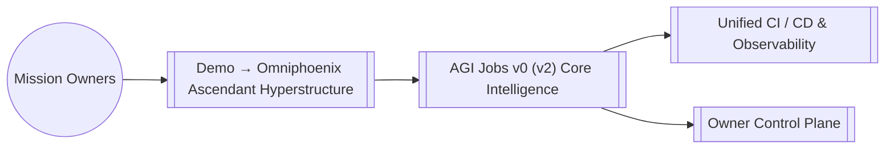

# Omniphoenix Ascendant Hyperstructure

A preserved scenario design and a guide to shared ASI Take-Off fixtures. The plan's jobs, participant handles, governance labels and physical projects are illustrative context. These files do not establish deployed identities, completed work or production readiness.

## Supported path

This directory has no independent executable entrypoint. Its runbook binds the existing scenario plan to the shared ASI Take-Off report pipeline.

Read the [runbook](RUNBOOK.md) and the [root setup](../../docs/START_HERE.md#reproduce-the-local-baseline). Use the pinned toolchain and locked dependencies. The plan remains in [project-plan.hyperstructure.json](project-plan.hyperstructure.json); no conversion to the Aurora mission schema is implied.

- `demo:asi-takeoff` reads `ASI_TAKEOFF_PLAN_PATH` for report context. Its normal mode runs fixed lifecycle/pause fixtures and separately bootstrapped reporting fixtures, not the scenario job list.
- `demo:asi-takeoff:local` is a different launcher. It uses `AURORA_MISSION_CONFIG`, defaults to the shared three-job `mission@v2.json`, and does not consume `ASI_TAKEOFF_PLAN_PATH`.
- `demo:asi-takeoff:kit -- --plan FILE ...` hashes the explicitly selected plan and supplied report files. It does not verify completed scenario work or ownership authority.

## Systems map — preserved original design

The original diagram describes the intended architecture, not execution evidence.

## Separate operator workflows

Owner-control changes, monitoring, validator operations, emergency drills and publication require their own configuration, evidence and authorization. See the [operator runbook](../../OperatorRunbook.md) and [ASI Take-Off runbook](../asi-takeoff/RUNBOOK.md). A successful fixture run does not authorize production operations.
