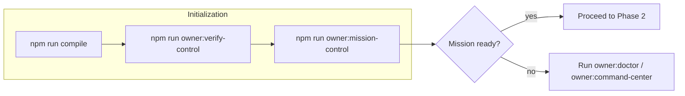
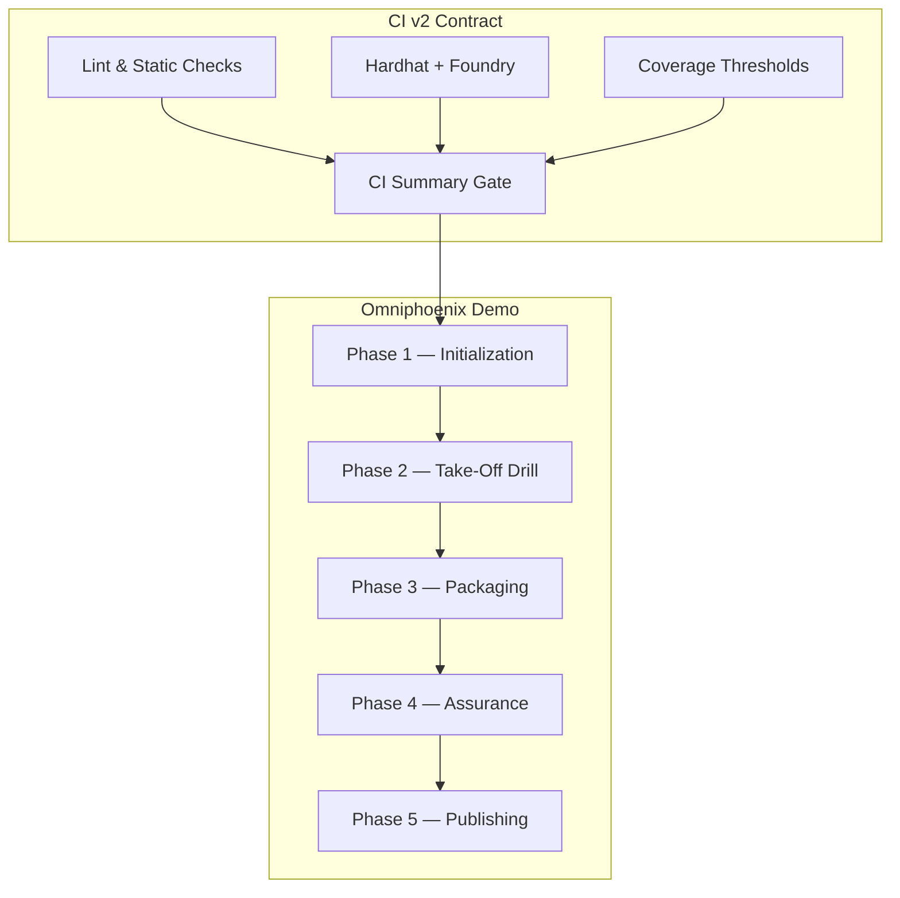

# Omniphoenix Ascendant Hyperstructure — Fixture Runbook

## Evidence scope

This directory contains a scenario plan and documentation, not its own executable pipeline. The preserved plan is compatible with the ASI Take-Off planning schema. The existing `demo:asi-takeoff` command reads it as report context; it does not execute the listed jobs, resolve its participant handles or deliver planetary infrastructure.

The command `demo:asi-takeoff:local` instead launches `demo/asi-takeoff/bin/asi-takeoff-local.sh`. It consumes `AURORA_MISSION_CONFIG` (the shared three-job fixture by default) and ignores `ASI_TAKEOFF_PLAN_PATH`. Do not use it to claim execution of the Omniphoenix plan.

## 1. Read-only planning

After following the [root setup](../../docs/START_HERE.md#reproduce-the-local-baseline), analyze the existing plan without starting a pipeline:

```bash
node -e 'const {analyze}=require("./demo/asi-takeoff/scripts/plan.cjs"); console.log(JSON.stringify(analyze(require("./demo/OMNIPHOENIX-ASCENDANT-HYPERSTRUCTURE/project-plan.hyperstructure.json")),null,2));'
```

This checks the existing planning schema, budgets and dependency graph. It does not validate ownership labels or provision real jobs. The original plan is retained unchanged.

## 2. Explicit shared-fixture reports

The following is an explicit request to generate illustrative offline evidence. It creates a fresh report directory so previous evidence is not overwritten:

```bash
PLAN=demo/OMNIPHOENIX-ASCENDANT-HYPERSTRUCTURE/project-plan.hyperstructure.json
mkdir -p reports
REPORT_ROOT="$(mktemp -d "$PWD/reports/omniphoenix.XXXXXX")"
AGIJOBS_FLAGSHIP_SKIP_ONCHAIN=true \
  ASI_TAKEOFF_PLAN_PATH="$PLAN" \
  ASI_TAKEOFF_REPORT_ROOT="$REPORT_ROOT" \
  HARDHAT_NETWORK=hardhat npm run demo:asi-takeoff
```

To explicitly run the shared contract rehearsal after separately preparing dependencies, use `AGIJOBS_FLAGSHIP_SKIP_ONCHAIN=false`. The TS pipeline regenerates constants and compiles, then runs two fixed scenarios in `scripts/v2/testnetDryRun.ts`: a job-lifecycle fixture and a SystemPause fixture. Thermodynamics and owner reports come from separately bootstrapped local fixtures. None of these components iterates over the Omniphoenix job list. Offline mode instead emits simulated reports with checks marked not run.

A normal run may compile and transact on disposable Hardhat fixtures. Do not point this recipe at production. Preserve the selected plan and report-root variables for the next step; direct TS invocations do not use the Omnigenesis wrapper's archive/lock mechanism.

## 3. Bind the governance kit explicitly

```bash
npm run demo:asi-takeoff:kit -- \
  --plan "$PLAN" \
  --report-root "$REPORT_ROOT" \
  --summary-md "$REPORT_ROOT/summary.md" \
  --bundle "$REPORT_ROOT/mission-bundle" \
  --logs "$REPORT_ROOT/logs" \
  --network hardhat
```

`--plan` is required here to select Omniphoenix. The kit CLI does not inherit `ASI_TAKEOFF_PLAN_PATH`: without `--plan`, its regular default is the national ASI Take-Off plan. Its separate `--local-receipts` mode defaults to the shared Aurora mission config. Do not combine that mode with these TS-pipeline reports.

Inspect `governance-kit.json` and `governance-kit.md` in the chosen scope. Check the initiative and the `plan` artifact's path and SHA-256 against the selected file. The summary job list is planned context. Hashes establish recorded bytes only; they do not establish completed work, authority, production readiness or settlement approval. Directory entries are an index rather than recursively hashed artifacts.

The complete TS report set includes `dry-run.json`, `thermodynamics.json`, `mission-control.md`, `summary.md`, `summary.json`, `run-status.json`, `logs/` and `mission-bundle/`. The Aurora report command reads a different receipt schema and is not a renderer for this report set.

## 4. CI and separate operator workflows

For optional CI integration, use the same explicit plan/report-root bindings for the TS command and kit command, keep offline and contract evidence visibly distinct, and upload only that run's unique report directory. See the existing [ASI Take-Off workflow](../../.github/workflows/demo-asi-takeoff.yml) for the distinction between TS reports and local Aurora receipts. A passing workflow is not production qualification.

Owner atlas/parameter surfaces, monitoring, validator rotation, emergency pause drills and storage publication are separate workflows. Follow the [operator runbook](../../OperatorRunbook.md) with reviewed deployment details and authorization. These operations do not happen automatically in this scenario's report pipeline, and publication does not certify its claims.

## Original design maps

These diagrams are preserved from the original design guide. Their arrows describe the intended architecture; they are not an executable procedure or evidence of performed checks.





## Review checklist

- [ ] The selected plan's exact bytes match the kit's `plan` hash.
- [ ] Reports disclose offline fixtures or shared local contract fixtures correctly.
- [ ] No report claims the scenario job list was executed.
- [ ] Previous evidence is retained in its own directory; partial runs remain available for diagnosis.
- [ ] Any later operator action is reviewed and authorized separately.

Completing this checklist reviews fixture evidence only. It does not approve production or settlement.
