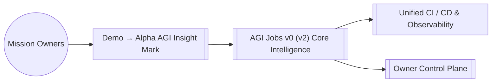

# AGI Jobs v0 (v2) — Demo → Alpha AGI Insight Mark

## Execution boundary

The default run is a **disposable local rehearsal**. Before any contract write,
it requires the actual in-process Hardhat EDR provider, chain 31337, block zero,
a valid instance identity and no fork. The legacy `AGIJOBS_DEMO_DRY_RUN=true`
name means local simulated transactions, not a read-only external-network run.
An external network with this default fails closed.

External configuration must explicitly name a non-reserved network, HTTP(S) RPC,
positive chain ID and valid distinct account keys. It cannot replace the reserved
`hardhat` network. External execution additionally requires
`AGIJOBS_DEMO_DRY_RUN=false` and the existing interactive `LAUNCH` confirmation.
Five distinct configured actors are required. RPC chain ID and configured owner
checks occur before deployment. These gates do not authorize a transaction on
anyone's behalf or establish adequate funding/production readiness.

The execution-mode regression uses inert provider/configuration fixtures only;
no external RPC, key or deployment is used. Actual local/production commissioning
remains a separate end-to-end gate. Recaps record `executionMode` explicitly.

> AGI Jobs v0 (v2) is our sovereign intelligence engine; this module extends that superintelligent machine with specialised capabilities for `demo/alpha-agi-insight-mark`.

## Overview
- **Path:** `demo/alpha-agi-insight-mark/README.md`
- **Module Focus:** Anchors Demo → Alpha AGI Insight Mark inside the AGI Jobs v0 (v2) lattice so teams can orchestrate economic, governance, and operational missions with deterministic guardrails.
- **Integration Role:** Interfaces with the unified owner control plane, telemetry mesh, and contract registry to deliver end-to-end resilience.

## Capabilities
- Provides opinionated configuration and assets tailored to `demo/alpha-agi-insight-mark` while remaining interoperable with the global AGI Jobs v0 (v2) runtime.
- Ships with safety-first defaults so non-technical operators can activate the experience without compromising security or compliance.
- Publishes ready-to-automate hooks for CI, observability, and ledger reconciliation.

## Systems Map

## Working With This Module
1. From the repository root run `npm install` once to hydrate all workspaces.
2. Inspect the scripts under `scripts/` or this module's `package.json` entry (where applicable) to discover targeted automation for `demo/alpha-agi-insight-mark`.
3. Execute `npm test` and `npm run lint --if-present` before pushing to guarantee a fully green AGI Jobs v0 (v2) CI signal.
4. Capture mission telemetry with `make operator:green` or the module-specific runbooks documented in [`OperatorRunbook.md`](../../OperatorRunbook.md).

## Directory Guide
### Key Directories
- `contracts`
- `data`
- `docs`
- `reports`
- `runbooks`
- `scripts`
- `test`
### Key Files
- `.gitignore`
- `hardhat.config.ts`
- `tsconfig.json`

## Quality & Governance
- Every change must land through a pull request with all required checks green (unit, integration, linting, security scan).
- Reference [`RUNBOOK.md`](../../RUNBOOK.md) and [`OperatorRunbook.md`](../../OperatorRunbook.md) for escalation patterns and owner approvals.
- Keep secrets outside the tree; use the secure parameter stores wired to the AGI Jobs v0 (v2) guardian mesh.

## Next Steps
- Review this module's issue board for open automation, data, or research threads.
- Link new deliverables back to the central manifest via `npm run release:manifest`.
- Publish artefacts (dashboards, mermaid charts, datasets) into `reports/` for downstream intelligence alignment.
