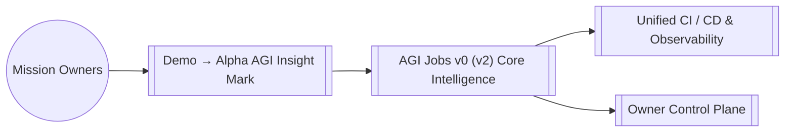

# AGI Jobs v0 (v2) — Demo → Alpha AGI Insight Mark

## Execution boundary

The default run is a **disposable local rehearsal**. Before any contract write,
it requires the actual in-process Hardhat EDR provider, chain 31337, block zero,
a valid instance identity and no fork. The legacy `AGIJOBS_DEMO_DRY_RUN=true`
name means local simulated transactions, not a read-only external-network run.
An external network with this default fails closed.

External configuration must explicitly name a non-reserved network, HTTP(S) RPC,
positive chain ID and valid distinct account keys. It cannot replace the reserved
`hardhat` network. External execution additionally requires
`AGIJOBS_DEMO_DRY_RUN=false` and the existing interactive `LAUNCH` confirmation.
Five distinct configured actors are required. RPC chain ID and configured owner
checks occur before deployment. These gates do not authorize a transaction on
anyone's behalf or establish adequate funding/production readiness.

The execution-mode regression uses inert provider/configuration fixtures only;
no external RPC, key or deployment is used. Actual local/production commissioning
remains a separate end-to-end gate. Recaps record `executionMode` explicitly.


## Retained CI evidence

The `alpha-agi-insight-mark-dossiers` artifact preserves the `reports/`, `data/`
and `artifacts/` layout. It includes the report manifest and every one of its
19 explicitly allowed files (including local receipts), the three contract
artifacts and their debug references, and only the deduplicated build-info files
those references name. A new staging directory is mandatory for each run.
There is no workspace, report-directory or build-info wildcard collection.

After the fresh-local preflight and completed scenario, receipt capture reads
actual mined JSON-RPC receipts for every transaction in blocks 1 through the
final local block. Bounded block records retain the actual block number/hash and
ordered transaction hashes, including empty blocks. Receipt transaction indices
must match those records; mined logs require matching block/transaction positions
and contiguous per-block log indices. These are structural consistency checks,
not independent chain attestation or settlement proof. Capture preserves raw
receipt contents unchanged. It does not serialize providers, signers, environment values,
keys or connection URLs. Broadcast runs do not produce local receipt evidence.
The report manifest is finalized only after receipt capture and all report
writes; a new run first removes old completion markers.

`retention-manifest.json` labels this evidence **fresh-local-hardhat-31337-only**.
It records the actual checkout commit/tree separately from the PR head commit/tree
(a PR merge checkout need not have the head's SHA), compiler versions/settings,
source and ABI fingerprints, bytecode fingerprints, config and lockfile hashes,
and a bounded file/size/hash inventory. Staging requires tracked execution inputs
to match the checkout, authored Solidity to match committed content, and embedded
dependency Solidity to match the installed dependency files. This is source-bound
compiler output retention, not an independent compiler rebuild or a proof of
production deployment; installed dependencies still rely on the CI `npm ci`
lockfile workflow.

Both staging and independent verification reject missing/extra files, checksum
changes, symlinks, traversal, unexpected source paths, nonlocal evidence,
artifact/ABI/bytecode discrepancies and oversized input. Bounds are 40 retained
files, 32 MiB per file, 96 MiB total, 128 source files per build-info, and 4096
local blocks/receipts. Only 0.8.37 / Cancun / viaIR / optimizer 500 is accepted.
The verifier checks all dossier transaction references against raw receipts.

From the repository root, after extracting an artifact into `EVIDENCE_DIR`:

```sh
node demo/alpha-agi-insight-mark/scripts/retainEvidence.cjs verify EVIDENCE_DIR
node --test demo/alpha-agi-insight-mark/script-tests/retention-evidence.test.cjs
```

Verification checks internal consistency and fingerprints; it does not authenticate
an archive's publisher. Compare checkout/head provenance with the trusted CI run.
The workflow runs synthetic retention regressions, unit tests, a new local demo,
existing dossier checks, then stages and verifies the exact upload directory
before upload. These are required qualification gates for any retention change;
passing synthetic fixtures alone does not qualify a real compiler/scenario run.


> AGI Jobs v0 (v2) is our sovereign intelligence engine; this module extends that superintelligent machine with specialised capabilities for `demo/alpha-agi-insight-mark`.

## Overview
- **Path:** `demo/alpha-agi-insight-mark/README.md`
- **Module Focus:** Anchors Demo → Alpha AGI Insight Mark inside the AGI Jobs v0 (v2) lattice so teams can orchestrate economic, governance, and operational missions with deterministic guardrails.
- **Integration Role:** Interfaces with the unified owner control plane, telemetry mesh, and contract registry to deliver end-to-end resilience.

## Capabilities
- Provides opinionated configuration and assets tailored to `demo/alpha-agi-insight-mark` while remaining interoperable with the global AGI Jobs v0 (v2) runtime.
- Ships with safety-first defaults so non-technical operators can activate the experience without compromising security or compliance.
- Publishes ready-to-automate hooks for CI, observability, and ledger reconciliation.

## Systems Map


## Working With This Module
1. From the repository root run `npm install` once to hydrate all workspaces.
2. Inspect the scripts under `scripts/` or this module's `package.json` entry (where applicable) to discover targeted automation for `demo/alpha-agi-insight-mark`.
3. Execute `npm test` and `npm run lint --if-present` before pushing to guarantee a fully green AGI Jobs v0 (v2) CI signal.
4. Capture mission telemetry with `make operator:green` or the module-specific runbooks documented in [`OperatorRunbook.md`](../../OperatorRunbook.md).

## Directory Guide
### Key Directories
- `contracts`
- `data`
- `docs`
- `reports`
- `runbooks`
- `scripts`
- `test`
### Key Files
- `.gitignore`
- `hardhat.config.ts`
- `tsconfig.json`

## Quality & Governance
- Every change must land through a pull request with all required checks green (unit, integration, linting, security scan).
- Reference [`RUNBOOK.md`](../../RUNBOOK.md) and [`OperatorRunbook.md`](../../OperatorRunbook.md) for escalation patterns and owner approvals.
- Keep secrets outside the tree; use the secure parameter stores wired to the AGI Jobs v0 (v2) guardian mesh.

## Next Steps
- Review this module's issue board for open automation, data, or research threads.
- Link new deliverables back to the central manifest via `npm run release:manifest`.
- Publish artefacts (dashboards, mermaid charts, datasets) into `reports/` for downstream intelligence alignment.
