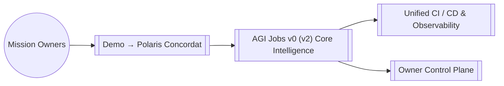

# AGI Jobs v0 (v2) — Demo → Polaris Concordat

> AGI Jobs v0 (v2) is our sovereign intelligence engine; this module extends that superintelligent machine with specialised capabilities for `demo/polaris-concordat`.

## Run the bounded quorum recovery rehearsal

This executable deploys the existing modular ValidationModule and StakeManager on a fresh, in-process, unforked Hardhat chain (31337). Token, job registry and identity contracts are explicitly mocks. No external RPC, wallet, funding or live assets are used.

With the repository's pinned Node version and locked dependencies installed:

```sh
npm run compile
node demo/polaris-concordat/run.cjs
node --test test/scripts/polaris-quorum.test.cjs
```

The default first committee has three validators but only one reveal. The real contract fails its unchanged 100% reveal quorum, deducts 1% of each missing validator's mock stake, transfers those mock penalties to the fixture employer and records temporary bans. A separate retry job uses three fresh, already-staked validators. Their three reveals and three approvals succeed. This illustrates replacement availability; it does not reopen a finalized job or demonstrate production identity selection.

Try `--initial-reveals 0` for total initial unavailability, or `--replacement-approvals 1` for a replacement committee that participates fully but rejects the work. Both controls accept integers 0 through 3. The actual approval threshold is two approvals out of three; the reveal quorum remains three out of three. All six fixture validators start with 1,000 mock tokens. No policy is weakened between rounds.

Every run writes a new `reports/polaris-*/result.json`. It includes canonical local finalization receipts, raw logs, contract runtime hashes and mock markers, observed balances/bans, unchanged policy snapshots and an independent receipt/economic consistency review. The runner verifies transaction/block provenance against its live local provider before export. The offline reviewer can detect inconsistent supplied evidence; it cannot authenticate an imported chain or verify arbitrary runtime hashes against a deployment authority. Exported `chainAttested`, `productionApproved` and `settlementApproved` remain false.

Tests run fresh subprocesses with bounded timeouts, cover zero/full/partial initial participation, insufficient replacement approvals, remote/forked/impersonated provider rejection and tampered receipts, stakes, policies and mock markers. The browser workspace only inspects supplied evidence and computes explicitly hypothetical outcomes. It never deploys contracts or signs transactions.

## Preserved design context

The following original design and diagram describe broader ambitions. Only the bounded rehearsal above is implemented here; the design is not evidence of production capabilities.

## Overview

- **Path:** `demo/polaris-concordat/README.md`
- **Module Focus:** Anchors Demo → Polaris Concordat inside the AGI Jobs v0 (v2) lattice so teams can orchestrate economic, governance, and operational missions with deterministic guardrails.
- **Integration Role:** Interfaces with the unified owner control plane, telemetry mesh, and contract registry to deliver end-to-end resilience.

## Capabilities

- Provides opinionated configuration and assets tailored to `demo/polaris-concordat` while remaining interoperable with the global AGI Jobs v0 (v2) runtime.
- Ships with safety-first defaults so non-technical operators can activate the experience without compromising security or compliance.
- Publishes ready-to-automate hooks for CI, observability, and ledger reconciliation.

## Systems Map



## Working With This Module

1. From the repository root run `npm install` once to hydrate all workspaces.
2. Inspect the scripts under `scripts/` or this module's `package.json` entry (where applicable) to discover targeted automation for `demo/polaris-concordat`.
3. Execute `npm test` and `npm run lint --if-present` before pushing to guarantee a fully green AGI Jobs v0 (v2) CI signal.
4. Capture mission telemetry with `make operator:green` or the module-specific runbooks documented in [`OperatorRunbook.md`](../../OperatorRunbook.md).

## Directory Guide

`run.cjs` executes the local EVM fixture; `review.cjs` validates exported evidence consistency; the original design remains below.

## Quality & Governance

- Every change must land through a pull request with all required checks green (unit, integration, linting, security scan).
- Reference [`RUNBOOK.md`](../../RUNBOOK.md) and [`OperatorRunbook.md`](../../OperatorRunbook.md) for escalation patterns and owner approvals.
- Keep secrets outside the tree; use the secure parameter stores wired to the AGI Jobs v0 (v2) guardian mesh.

## Next Steps

- Review this module's issue board for open automation, data, or research threads.
- Link new deliverables back to the central manifest via `npm run release:manifest`.
- Publish artefacts (dashboards, mermaid charts, datasets) into `reports/` for downstream intelligence alignment.
