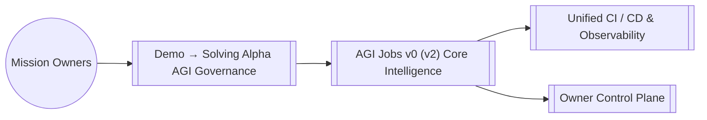

# AGI Jobs v0 (v2) — Demo → Solving Alpha AGI Governance

> An inspectable, offline rehearsal of proposal approval and budget gates, with a bilingual browser workspace and a matching Python evaluator.

## Try the bounded proposal rehearsal

This directory now contains an executable **offline simulation** of a maintenance-budget decision. It checks quorum, approval share, available budget and required owner controls. It reuses the existing governance engine's owner-control coverage calculation. It does not enact governance, authenticate voter identities, read a live electorate, transfer funds or certify a production deployment.

```bash
python demo/solving-alpha-agi-governance/run.py
python -m unittest discover -s test/simulation -p test_governance_rehearsal.py -v
```

The default scenario proposes 420,000 synthetic cents from a 500,000-cent budget. Seventy of ninety cast vote units approve; ninety of one hundred eligible units participate. All four checks pass and the hypothetical remaining budget is 80,000 cents. `enacted` and `settlementApproved` remain false. These are illustrative budget units, not a payment.

### Change one thing and explain the outcome

Copy [scenario.json](scenario.json), edit it and run `python demo/solving-alpha-agi-governance/run.py --scenario YOUR_COPY.json`:

- Raise `quorumPercent` from 60 to 95: participation fails.
- Raise `approvalPercent` from 67 to 80: approval fails.
- Set `requestedCents` to 500001: available budget fails.
- Remove `pause` from `controls`: required owner control fails.

The JSON result reports each check and the failing reasons. Abstentions count toward participation and the approval denominator: approval is measured against all cast vote weight, not only approve/reject votes. Arithmetic uses integer cross-products, so exact threshold decisions do not depend on floating-point rounding. A rejected proposal returns exit status 1 and leaves the hypothetical budget unchanged; malformed input returns 2. Duplicate JSON keys, non-finite numbers, unknown fields, duplicate voter identifiers, excess weight, boolean numeric values and unsafe identifiers are rejected. The CLI commits the exact scenario bytes with SHA-256.

This rehearsal treats the supplied votes and control names as scenario data. Real governance requires authenticated identities, authoritative voting power, separately enforced permissions and the target contract's own rules. The [related governance workflow](../agi-governance/README.md) and [complete demo guide](../README.md) remain available. Existing architecture diagrams below are preserved design context, not evidence that this small simulation operates the wider system.

### Use the browser workspace

Serve `demo/solving-alpha-agi-governance/web/` with a local static server, then open its index page. For example, run `python -m http.server 8080 --bind 127.0.0.1 --directory demo/solving-alpha-agi-governance/web` and visit `http://127.0.0.1:8080/`. The complete Pages build publishes the same workspace at `experiments/governance/` when this change is deployed.

Switch between English and French, change one gate, and download the exact scenario or an evidence bundle. Reopening a bundle recomputes its result from the scenario rather than trusting its saved result. The browser labels the hash of its exported scenario `downloadedScenarioSha256`; the CLI separately hashes the exact bytes it reads. Neither hash proves voter identity or grants authority.

## Preserved architectural design

The following overview and systems map describe the wider design, beyond the bounded implementation above.

### Overview

- **Path:** `demo/solving-alpha-agi-governance/README.md`
- **Module Focus:** Anchors Demo → Solving Alpha AGI Governance inside the AGI Jobs v0 (v2) lattice so teams can orchestrate economic, governance, and operational missions with deterministic guardrails.
- **Integration Role:** Interfaces with the unified owner control plane, telemetry mesh, and contract registry to deliver end-to-end resilience.

## Capabilities

- Provides opinionated configuration and assets tailored to `demo/solving-alpha-agi-governance` while remaining interoperable with the global AGI Jobs v0 (v2) runtime.
- Ships with safety-first defaults so non-technical operators can activate the experience without compromising security or compliance.
- Publishes ready-to-automate hooks for CI, observability, and ledger reconciliation.

## Systems Map



## Working With This Module

1. From the repository root run `npm install` once to hydrate all workspaces.
2. Inspect the scripts under `scripts/` or this module's `package.json` entry (where applicable) to discover targeted automation for `demo/solving-alpha-agi-governance`.
3. Execute `npm test` and `npm run lint --if-present` before pushing to guarantee a fully green AGI Jobs v0 (v2) CI signal.
4. Capture mission telemetry with `make operator:green` or the module-specific runbooks documented in [`OperatorRunbook.md`](../../OperatorRunbook.md).

## Directory Guide

`run.py` evaluates `scenario.json`; behavioral acceptance tests live in `test/simulation/test_governance_rehearsal.py`. The broader design guide and diagram remain below for context.

## Quality & Governance

- Every change must land through a pull request with all required checks green (unit, integration, linting, security scan).
- Reference [`RUNBOOK.md`](../../RUNBOOK.md) and [`OperatorRunbook.md`](../../OperatorRunbook.md) for escalation patterns and owner approvals.
- Keep secrets outside the tree; use the secure parameter stores wired to the AGI Jobs v0 (v2) guardian mesh.

## Next Steps

- Review this module's issue board for open automation, data, or research threads.
- Link new deliverables back to the central manifest via `npm run release:manifest`.
- Publish artefacts (dashboards, mermaid charts, datasets) into `reports/` for downstream intelligence alignment.
