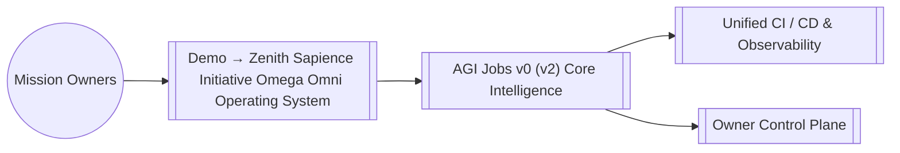

# AGI Jobs v0 (v2) — Demo → Zenith Sapience Initiative Omega Omni Operating System

> AGI Jobs v0 (v2) is our sovereign intelligence engine; this module extends that superintelligent machine with specialised capabilities for `demo/zenith-sapience-initiative-omega-omni-operating-system`.

## Execute and resume a local artifact pipeline

This bounded executable performs real local file work using the fixed One-Box synthetic supplier quotes and independent acceptance reviewer. It does not call a model, drive a browser, purchase anything, sign a transaction or execute arbitrary commands.

```sh
node demo/zenith-sapience-initiative-omega-omni-operating-system/run.cjs
node demo/zenith-sapience-initiative-omega-omni-operating-system/run.cjs --stop-after 2
node demo/zenith-sapience-initiative-omega-omni-operating-system/run.cjs --resume RUN_ID_FROM_OUTPUT
node --test test/scripts/omega-pipeline.test.cjs
```

Five built-in stages validate the fixed quotes, compute a comparison, write a recommendation, independently review both artifacts and export a delivery receipt. The outputs are actual JSON/Markdown files in a newly created `reports/omega-local-pipeline/run-...` directory. They are deterministic code-generated work, not model-generated output or computer-use evidence.

Each stage is recorded once with its source hashes, exact predecessor hash, options and data. Resume accepts only a generated run identifier within the fixed reports directory. Before continuing it recomputes every existing stage against the current source and compares exact bytes. Modified source, altered artifacts, gaps, unexpected files or symlink checkpoints fail closed. Existing records are never overwritten. Atomic link publication prevents a partial record from becoming a completed checkpoint; orphan `.pending-*` files can remain after an interruption. This is local process-interruption recovery, not a claim of power-loss durability, hostile-user isolation or tamper-proof storage.

`--stop-after 1..5` deliberately stops after a stage. `--inject-error` writes a wrong supplier recommendation: the independent reviewer rejects it at stage four and no delivery receipt is exported. To inspect the same rejected run again, resume with the same error option. Corrected work starts a new run; changing the recorded options during resume is rejected.

Exit `0` means all five local stages completed and the fixed review passed. Exit `1` means deliberate interruption or review rejection. Exit `2` means invalid controls, unreadable or inconsistent checkpoints, or a failed filesystem operation. Every run remains unadmitted, with production and settlement approval false. The signed Alpha computer executor and on-chain JobRegistry path remain separate opt-in integrations; this demo grants neither authority.

## Preserved design context

The original architecture and broader runbooks below are retained. The implemented scope here is the local, source-bound artifact pipeline above.

## Overview

- **Path:** `demo/zenith-sapience-initiative-omega-omni-operating-system/README.md`
- **Module Focus:** Anchors Demo → Zenith Sapience Initiative Omega Omni Operating System inside the AGI Jobs v0 (v2) lattice so teams can orchestrate economic, governance, and operational missions with deterministic guardrails.
- **Integration Role:** Interfaces with the unified owner control plane, telemetry mesh, and contract registry to deliver end-to-end resilience.

## Capabilities

- Provides opinionated configuration and assets tailored to `demo/zenith-sapience-initiative-omega-omni-operating-system` while remaining interoperable with the global AGI Jobs v0 (v2) runtime.
- Ships with safety-first defaults so non-technical operators can activate the experience without compromising security or compliance.
- Publishes ready-to-automate hooks for CI, observability, and ledger reconciliation.

## Systems Map



## Working With This Module

1. From the repository root run `npm install` once to hydrate all workspaces.
2. Inspect the scripts under `scripts/` or this module's `package.json` entry (where applicable) to discover targeted automation for `demo/zenith-sapience-initiative-omega-omni-operating-system`.
3. Execute `npm test` and `npm run lint --if-present` before pushing to guarantee a fully green AGI Jobs v0 (v2) CI signal.
4. Capture mission telemetry with `make operator:green` or the module-specific runbooks documented in [`OperatorRunbook.md`](../../OperatorRunbook.md).

## Directory Guide

### Key Files

- `ARTIFACTS.md`
- `ASSURANCE.md`
- `OWNER_CONTROL.md`
- `RUNBOOK.md`

## Quality & Governance

- Every change must land through a pull request with all required checks green (unit, integration, linting, security scan).
- Reference [`RUNBOOK.md`](../../RUNBOOK.md) and [`OperatorRunbook.md`](../../OperatorRunbook.md) for escalation patterns and owner approvals.
- Keep secrets outside the tree; use the secure parameter stores wired to the AGI Jobs v0 (v2) guardian mesh.

## Next Steps

- Review this module's issue board for open automation, data, or research threads.
- Link new deliverables back to the central manifest via `npm run release:manifest`.
- Publish artefacts (dashboards, mermaid charts, datasets) into `reports/` for downstream intelligence alignment.
