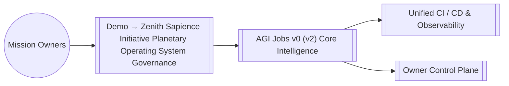

# AGI Jobs v0 (v2) — Demo → Zenith Sapience Initiative Planetary Operating System Governance

## Local execution scope

`npm run demo:zenith-sapience-planetary-os:local` rehearses the shared ASI Global contract-lifecycle
fixture at `demo/asi-global/config/mission@v2.json`, with reports under
`reports/localhost/zenith-planetary-os/`. The three fixture jobs are Renewable Capacity
Surge, Climate Resilience Mesh, and Governance Synchronisation. This does not
execute this directory's branded `project-plan.json` or establish delivery of its
proposed real-world programmes. The plan remains design and governance-kit context.

A valid `AURORA_MISSION_CONFIG` can select another Aurora mission fixture; setting
`ASI_GLOBAL_PLAN_PATH` (even to an empty string) is rejected by this local wrapper
before locks, report archival, or node startup. See the
[shared-scenario contract](../asi-global/LOCAL-SCENARIOS.md) for configuration and
evidence limits.

> AGI Jobs v0 (v2) is our sovereign intelligence engine; this module extends that superintelligent machine with specialised capabilities for `demo/zenith-sapience-initiative-planetary-operating-system-governance`.

## Overview
- **Path:** `demo/zenith-sapience-initiative-planetary-operating-system-governance/README.md`
- **Module Focus:** Anchors Demo → Zenith Sapience Initiative Planetary Operating System Governance inside the AGI Jobs v0 (v2) lattice so teams can orchestrate economic, governance, and operational missions with deterministic guardrails.
- **Integration Role:** Interfaces with the unified owner control plane, telemetry mesh, and contract registry to deliver end-to-end resilience.

## Capabilities
- Provides opinionated configuration and assets tailored to `demo/zenith-sapience-initiative-planetary-operating-system-governance` while remaining interoperable with the global AGI Jobs v0 (v2) runtime.
- Ships with safety-first defaults so non-technical operators can activate the experience without compromising security or compliance.
- Publishes ready-to-automate hooks for CI, observability, and ledger reconciliation.

## Systems Map

## Working With This Module
1. From the repository root run `npm install` once to hydrate all workspaces.
2. Inspect the scripts under `scripts/` or this module's `package.json` entry (where applicable) to discover targeted automation for `demo/zenith-sapience-initiative-planetary-operating-system-governance`.
3. Execute `npm test` and `npm run lint --if-present` before pushing to guarantee a fully green AGI Jobs v0 (v2) CI signal.
4. Capture mission telemetry with `make operator:green` or the module-specific runbooks documented in [`OperatorRunbook.md`](../../OperatorRunbook.md).

## Directory Guide
### Key Directories
- `bin`
### Key Files
- `OWNER-CONTROL.md`
- `project-plan.json`
- `RUNBOOK.md`

## Quality & Governance
- Every change must land through a pull request with all required checks green (unit, integration, linting, security scan).
- Reference [`RUNBOOK.md`](../../RUNBOOK.md) and [`OperatorRunbook.md`](../../OperatorRunbook.md) for escalation patterns and owner approvals.
- Keep secrets outside the tree; use the secure parameter stores wired to the AGI Jobs v0 (v2) guardian mesh.

## Next Steps
- Review this module's issue board for open automation, data, or research threads.
- Link new deliverables back to the central manifest via `npm run release:manifest`.
- Publish artefacts (dashboards, mermaid charts, datasets) into `reports/` for downstream intelligence alignment.
