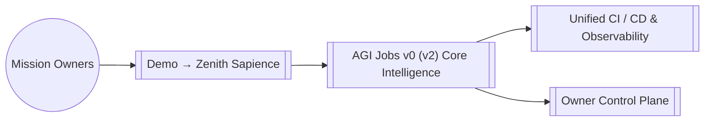

# AGI Jobs v0 (v2) — Demo → Zenith Sapience

> AGI Jobs v0 (v2) is our sovereign intelligence engine; this module extends that superintelligent machine with specialised capabilities for `demo/zenith-sapience`.

## Run the regional budget reconciliation desk

This offline workspace reuses the existing Hypernova workbench's exact-integer analyzer to compare regional budget envelopes, planned job amounts and supplied reported amounts. It produces reviewable transfer proposals in one declared unit. It does not move money, convert tokens, verify invoices or authorize work.

```sh
node demo/zenith-sapience/run.mjs
node demo/zenith-sapience/run.mjs path/to/scenario.json
node --test test/demo/zenith-reconciliation.test.mjs
```

Use the repository's pinned Node version. This entry point uses standard Node modules and existing repository code; no provider credentials are required. Input amounts are nonnegative integer strings, with up to 24 digits. JSON imports reject duplicate keys, noninteger numeric tokens, excessive nesting, unknown fields and invalid identifiers.

The default example intentionally leaves one reported job amount unknown. Its reported total remains `null`, regional subtotals are explicitly known-only, and all transfer proposals are held. Unknown is never silently treated as zero. Supply a declared amount to complete reconciliation; this is still a reported value, not an attested invoice.

When all reported amounts are present and regional envelopes match the declared total, the desk detects regional shortfalls even if the overall budget has headroom. It proposes transfers from regions with spare allocation, following region input order. Proposals conserve the declared unit and cannot draw more than a donor's reported headroom. If total resources are insufficient, partial proposals remain visible alongside the exact uncovered deficit and `fullyFundedAfterProposal: false`.

An empty proposal list can mean either no deficit or a hold; inspect `proposalHoldReasons` and `fullyFundedAfterProposal`. No currency conversion or automatic budget action is performed. `costAttested`, `transfersExecuted`, `productionApproved` and `settlementApproved` are always false. A fully funded proposal only describes consistency of supplied numbers.

The CLI prints the result and SHA-256 of the exact scenario bytes. Exit `0` means reported costs are complete and proposed allocations cover them; `1` means missing reports, unbalanced envelopes or an uncovered deficit; `2` means invalid or unreadable input. The reused analyzer's one-day scheduling fields are internal synthetic placeholders, not a delivery forecast.

## Preserved design context

The broader mission-stream designs and architecture diagrams below remain available. The bounded capability implemented here is regional budget reconciliation; these designs do not establish production or societal-scale execution.

## Overview

- **Path:** `demo/zenith-sapience/README.md`
- **Module Focus:** Anchors Demo → Zenith Sapience inside the AGI Jobs v0 (v2) lattice so teams can orchestrate economic, governance, and operational missions with deterministic guardrails.
- **Integration Role:** Interfaces with the unified owner control plane, telemetry mesh, and contract registry to deliver end-to-end resilience.

## Capabilities

- Provides opinionated configuration and assets tailored to `demo/zenith-sapience` while remaining interoperable with the global AGI Jobs v0 (v2) runtime.
- Ships with safety-first defaults so non-technical operators can activate the experience without compromising security or compliance.
- Publishes ready-to-automate hooks for CI, observability, and ledger reconciliation.

## Systems Map



## Working With This Module

1. From the repository root run `npm install` once to hydrate all workspaces.
2. Inspect the scripts under `scripts/` or this module's `package.json` entry (where applicable) to discover targeted automation for `demo/zenith-sapience`.
3. Execute `npm test` and `npm run lint --if-present` before pushing to guarantee a fully green AGI Jobs v0 (v2) CI signal.
4. Capture mission telemetry with `make operator:green` or the module-specific runbooks documented in [`OperatorRunbook.md`](../../OperatorRunbook.md).

## Directory Guide

### Key Files

- `architecture.md`
- `assurance-matrix.md`
- `mission-streams.md`

## Quality & Governance

- Every change must land through a pull request with all required checks green (unit, integration, linting, security scan).
- Reference [`RUNBOOK.md`](../../RUNBOOK.md) and [`OperatorRunbook.md`](../../OperatorRunbook.md) for escalation patterns and owner approvals.
- Keep secrets outside the tree; use the secure parameter stores wired to the AGI Jobs v0 (v2) guardian mesh.

## Next Steps

- Review this module's issue board for open automation, data, or research threads.
- Link new deliverables back to the central manifest via `npm run release:manifest`.
- Publish artefacts (dashboards, mermaid charts, datasets) into `reports/` for downstream intelligence alignment.
