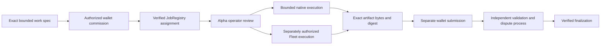

# Run bounded Alpha work for an AGI Jobs v0 commission

This integration identifies **AGI Jobs v0 JobRegistry v2 + $AGIALPHA** explicitly.
It does not replace Alpha's MARK / AscensionJobMarket route, the legacy
AGIJobManager, or the separate USDC Manager. Sharing a token symbol does not make
markets interchangeable.

Use **public, non-personal inputs only** for this integration's missions,
assessment and qualification. A source being public does not make personal data
eligible.

Continue a native Alpha dossier with retained history using the
[project receiver and bounded Jobs drafts](PROJECT_CONTINUITY.md). It preserves
the original bytes and performs actual fixed public-data work; its AGIALPHA
allowance remains an unfunded proposal.

## Choose your goal

| Goal                                       | Route                                      | What is supported here                                                      |
| ------------------------------------------ | ------------------------------------------ | --------------------------------------------------------------------------- |
| Execute a bounded local Alpha mission      | Alpha native executor                      | Exact work-spec and result commitments                                      |
| Send approved computer work to Fleet       | Alpha's separately selected Fleet executor | Use its bounded executor envelope; Fleet never decides settlement           |
| Verify a JobRegistry lifecycle transaction | Read-only receipt verifier                 | Canonical chain, full runtime pin, exact job/worker/artifact, confirmations |
| Use the existing Alpha planning HTTP API   | `services/alpha-bridge`                    | Existing gRPC planner proxy, not an on-chain adapter                        |
| Open paid production intake                | Operator deployment/readiness process      | Not enabled by this integration or the historical deployment record         |

## Start safely

1. Choose the explicit `agijobsv0-jobregistry-v2` backend. Keep the executor choice
   separate from the market and token identity.
2. Prepare the bounded work specification **before** creating a job. The fixture
   `fixtures/work-spec.json` is shared with Alpha and contains no job ID or
   assignment receipt. Its `specHash` is SHA-256 of its exact UTF-8 bytes:
   `0x1cb2ef99471efe7d7213d35ce64d87ed0f67dc8d60988501129a38e06a3ec815`.
   Do not reserialize it or append a newline. This is an explicit application
   convention; JobRegistry stores bytes32 commitments without selecting a hash
   algorithm. Existing applications using Keccak remain unchanged.
3. An authorized wallet creates and applies to the job. Applying is an atomic
   assignment to the first eligible caller, not a pending application awaiting
   an employer acceptance. Stake, identity, tax-policy, pause and capacity rules
   remain contract-controlled.
4. Bind the separate execution envelope to chain ID, token, registry, job ID,
   worker, source/deployment profile and exact specification hash. Independently
   verify current Applied state and admission requirements before execution.
5. Execute only the agreed bounded mission under Alpha's operator controls.
   Preserve the exact exported artifact bytes and their SHA-256 digest.
   Alpha export/verification and the Jobs local submission helper share an 8 MiB
   (8,388,608-byte) artifact ceiling; oversized files fail before submission.
   The receipt verifier reads only the committed bytes32 digest and URI, never
   the full artifact. A digest receipt does not verify artifact signatures or content.
6. An authorized wallet may separately submit the artifact commitment. Verify
   `ResultSubmitted` for the exact worker, job, digest and URI. Submission is
   not validation approval. `JobCompleted(success=true)` is not finalization.
7. Track validation, disputes and `JobFinalized` independently. A finalization
   event alone is not proof of a particular payout amount or economic outcome.



## Deployment identity matters

The [current mainnet directory](../../docs/production/CURRENT_MAINNET_DEPLOYMENT.md)
identifies the separate **18 October 2026** deployment: JobRegistry
`0x8b230eB346369B2a3EFaaa615CbEb8e3b2f167e6`, deployed from
`818b3a246871e4cd4dde86558dbb91ef82b15eef`. Its
[dated snapshot](../../docs/production/mainnet-2026-10-18/deployment-snapshot.json)
records 25 exact runtime/source comparisons, 46 named finalized-state checks and
all eight managed modules paused. These are retained observations, not a fresh
chain read or production approval. Current-main equivalence is not assumed.

`jobregistry-v2.json` records the current source profile separately from the
October 12 mainnet inventory. That inventory records registry
`0x72Ec2CcC9403b643C4d6CA3eF05E06ca8faa3084` and 23 other instances built from
`b4c5b66ea05a6bb27f1f1cb197f055c179bbd38e`. It explicitly does not approve
production or open live intake. Zero addresses in the generic current config
are not evidence that this historical deployment does not exist.

The profile's October 12 inventory remains historical and pinned in the receiver
source closure. The October 18 pointer does not replace that profile, install a
trusted deployment, switch a client or grant authority. Treat all previous
deployments as read-only. Any new reviewed profile requires its own exact-source,
runtime, wiring, policy and admission evidence.

For a separately authorized new creation, follow the
[owner-operated Hardhat requirements](../../docs/deployment-v2-agialpha.md#owner-operated-deployment-requirements):
Ubuntu Terminal, a local hidden prompt and a process-lifetime deployer key that
is never stored, printed, passed in arguments or written to `.env`, history or
logs. Ledger governance remains on Mac Studio. Live deployment, signing,
funding, activation and on-chain authority changes require separate authorization;
the approved ENS configuration work remains separate.

The historical masked runtime-template SHA-256 is **not** a full deployed
runtime Keccak-256 pin. Do not feed it into `runtimeKeccak256`. Independently
review full deployed code, immutable delegate addresses and their code,
module wiring, token identity, governance and current pause state at a canonical
block before installing a trusted deployment profile. The verifier checks an
individual receipt against that already-reviewed profile; it does not provide
profile approval, complete admission, payout reconciliation or audit assurance.
RPC data is a trust input; use a trusted provider and appropriate finality depth.

## Receipt verification API

`verify-receipt.cjs` exports `verifyReceipt(provider, trustedDeployment, expected)`.
The provider is an ethers-compatible read-only provider. The deployment requires
`backend`, positive integer `chainId`, nonzero `registry`, and a reviewed full
`runtimeKeccak256`. Expected input requires transaction hash, positive decimal
string job ID, one supported event and positive `minimumConfirmations`.
Worker is required except for `JobCompleted`; `ResultSubmitted` additionally
requires exact `resultHash` and `resultURI`; `JobCompleted` requires `success`.

The verifier fetches the receipt itself, checks chain, transaction success,
canonical block and depth, emitter/runtime identity and exact event fields,
binds each registry log to the receipt transaction/block and a valid log index,
rejects duplicate or removed matching logs, and rechecks the block afterward.
It never signs, submits, approves, deposits, acknowledges policy or settles.

Run focused tests with `npm run alpha-agent:verify:test`.

## Retain current Alpha computer evidence as an unfunded Jobs draft

`four-repo-computer-receipt.mjs` is an additive, inert bridge for the current
native Alpha `successor-alpha-computer-handoff/v1` and
`successor-alpha-computer-return/v1` formats. It preserves the exact handoff,
return and frozen supplier-mission report bytes. It does not replace the pinned
CSV project receiver, its source selector or its historical deployment profile.

Install the reviewed Alpha `inspectComputerReturn` function in application code
as `inspectAlphaReturn`; imported JSON cannot select code or a checkout. Call
`inspectComputerReceiptEvidence({handoffRaw, returnRaw, reportRaw},
{inspectAlphaReturn})` for the shared market-independent inspection. It replays
the native Jobs report, checks the exact shipped English/French desk HTML and
networkless public/non-personal input scope, binds the project/task/source and
exact observed result, and recomputes the frozen allocation against the real
requirements. Interrupted, unclean, missing, altered or wrongly bound returns
are rejected.

`createComputerReceiptDraft` accepts the same raw inputs and
`{amountBaseUnits, createdAt, inspectAlphaReturn}`. It returns a canonical
`agijobsv0/four-repo-computer-draft/v1` with an explicit **18-decimal AGIALPHA
unfunded proposal**. The native compiler's four sealed jobs still reserve zero;
the proposed amount does not fund or modify those sealed budgets. Import with
`inspectComputerReceiptDraft(raw, {inspectAlphaReturn})`, which rebuilds every
binding and the native drafts. A Manager USDC wrapper must select its own route
and budget; this bridge never converts USD quote prices, USDC or AGIALPHA.

Consistent native receipt bytes do not authenticate their author, prove actual
computer execution or satisfy independent acceptance. All outputs retain
`trustedComputerExecution: false`, independent review required, no authority,
and no settlement or production approval. A source-locked cross-repository
runner must separately retain the actual browser observations and runtime
evidence. A protocol fixture is not browser or live-model qualification.

The regular `npm run site:test` includes the bounded adapter regression suite.
For its separate native Alpha protocol-boundary test, use the repository's
pinned Node toolchain and an explicitly reviewed current Alpha checkout:

```bash
node test/pages/four-repo-computer-receipt-native.mjs /absolute/reviewed/alpha-checkout
```

That test uses the real native Alpha inspector with labeled synthetic protocol
receipts; it performs no browser, model, wallet or blockchain operation.
An optional second argument selects a new absolute output directory for its
four labeled protocol fixture files. No files are written by default, and an
existing output directory is refused. Unknown model and human costs remain
unknown in this fixture.

### Rehearse the current draft through disposable modular contracts

`four-repo-computer-lifecycle.cjs` commits the exact draft's SHA-256 as the job
specification and the exact native Alpha return's SHA-256 as the result. It uses
the actual modular JobRegistry and StakeManager with a mock token, permissive
identity and an operator-controlled validation stub. Successful work receives
the separately finalized mock reward. Rejected work remains disputed, cannot
finalize and receives no payout. This is a fixture of contract mechanics, not
independent content acceptance or production readiness.

Use Node **22.23.3**, npm **10.8.2**, a reviewed clean Alpha source pin and a new
evidence filename. Compile with the normal Solidity 0.8.37 / via-IR / 200-run
profile, then run only on the fresh in-process `hardhat` network:

```bash
npm ci --ignore-scripts --no-audit
npm run compile
FQR_DRAFT_FILE=/absolute/evidence/jobs-agialpha-draft.json \
FQR_ALPHA_SOURCE=/absolute/reviewed/alpha-checkout \
FQR_ALPHA_COMMIT=REPLACE_WITH_EXACT_REVIEWED_40_HEX_COMMIT \
FQR_EVIDENCE_FILE=/absolute/evidence/new-jobs-local-lifecycle.json \
npx hardhat run --no-compile --network hardhat integrations/alpha-agent/four-repo-computer-lifecycle.cjs
```

The script rejects external RPCs, forks, other networks, substituted Alpha
source, malformed drafts and existing evidence outputs before fixture writes.
The Alpha pin covers its entire tracked checkout, including transitive native
imports under `successor-workbench` and `build-successor`. Tracked modifications
and nonignored untracked source files are refused before importing the inspector;
tracked file bytes and modes are checked against the pinned Git objects, without
replacement refs, hidden index flags, environment redirection or symlinked source.
The same check runs again before writing lifecycle evidence. Normal ignored
dependencies and report outputs remain usable. These checks bind the inspected
checkout at those checkpoints; they do not establish a tamper-proof runtime or
authenticate historical computer observations.
`FQR_INPUT_CLASS` may record an external evidence label; it is not authenticated
runtime proof. Protocol-only inputs must remain labeled
`PROTOCOL_DOUBLE_NO_BROWSER`. No production key is required or authorized;
the fixture uses only disposable Hardhat signers, contacts no Mainnet RPC and
changes no existing deployment. The fixture's mock token
uses 18-decimal base units, without implying real AGIALPHA revenue.

## Reproduce the disposable-chain acceptance

The retained `fixtures/local-acceptance.json` records a real local assignment,
Alpha bounded execution, explicit local review, signed exact artifact export,
JobRegistry submission, separate validation-stub decision and finalization.
`fixtures/reviewed-artifact.json` preserves the exact signed bytes. The payout
check observed 100 **mock-token base units**, not real revenue. Permissive
identity and operator-controlled validation are explicitly fixture assumptions.
The CI JobRegistry integration suite replays the same spec/artifact commitment
through the actual modular Solidity lifecycle and verifies ABI parity.

For a new cross-repository rehearsal:

1. Start a disposable Hardhat localhost chain with chain ID 31337.
2. Run `npx hardhat run --network localhost integrations/alpha-agent/deploy-local-fixture.cjs`.
   It refuses a non-loopback RPC or other chain. `ALPHA_WORK_SPEC` can select an alternate exact-byte bounded specification.
   Output defaults to
   `/tmp/agijobsv0-alpha-fixture.json` (`ALPHA_FIXTURE_OUTPUT` overrides it).
3. Install its exact addresses/runtime pins as the Alpha operator's explicit
   `agialpha.jobs-v0-profile.v1` **disposable-local-fixture** profile. Map
   `stakeManager`→`stake`, `validationModule`→`validation`,
   `identityRegistry`→`identity`; keep the other contract keys unchanged.
4. Use Alpha's `alpha_factory_v1.core.runtime.ecosystem` admit, execute and export
   commands, with the separate explicit native review step. Preserve the signed
   artifact as `/tmp/agijobsv0-alpha-artifact.json`; write its `resultHash` and
   `resultURI` in `/tmp/agijobsv0-alpha-result.json`.
5. Run `npx hardhat run --network localhost integrations/alpha-agent/complete-local-fixture.cjs`.
   `ALPHA_ARTIFACT`, `ALPHA_RESULT`, and `ALPHA_ACCEPTANCE_OUTPUT` can override
   the corresponding temporary paths. It checks the exact artifact hash,
   submits using the known disposable wallet, verifies all four lifecycle
   receipts, rejects a substituted hash and checks the mock payout.

Keep the node and both repositories in the same network namespace. Never use
these known disposable accounts on a live chain. The scripts do not install
credentials or write any production configuration. The full cross-repository
rehearsal needs Alpha's matching adapter; the repository-local CI regression
uses the retained artifact rather than downloading another repository at test time.

### Large-artifact regression

`fixtures/large-local-acceptance.json` records a second real cross-repository
rehearsal using a 480 KB work specification and a 2,078,954-byte signed artifact,
above the former Alpha verifier's 2 MB limit. Alpha commit
`5cf5bdb51e6c9b4172e10dd45ba77cad8a645c02` executed, reviewed, exported and verified
it; the Jobs helper then read it within the shared 8 MiB cap and verified the
actual submission, approval and finalization receipts. The isolated mock payout
was 100 base units. This is historical local evidence, not production approval.
The large raw artifact and disposable identity are not published in this repository.
The exact 8 MiB and 8 MiB + 1 boundaries are separately covered by reader tests;
they are not mislabeled as signed end-to-end missions.
